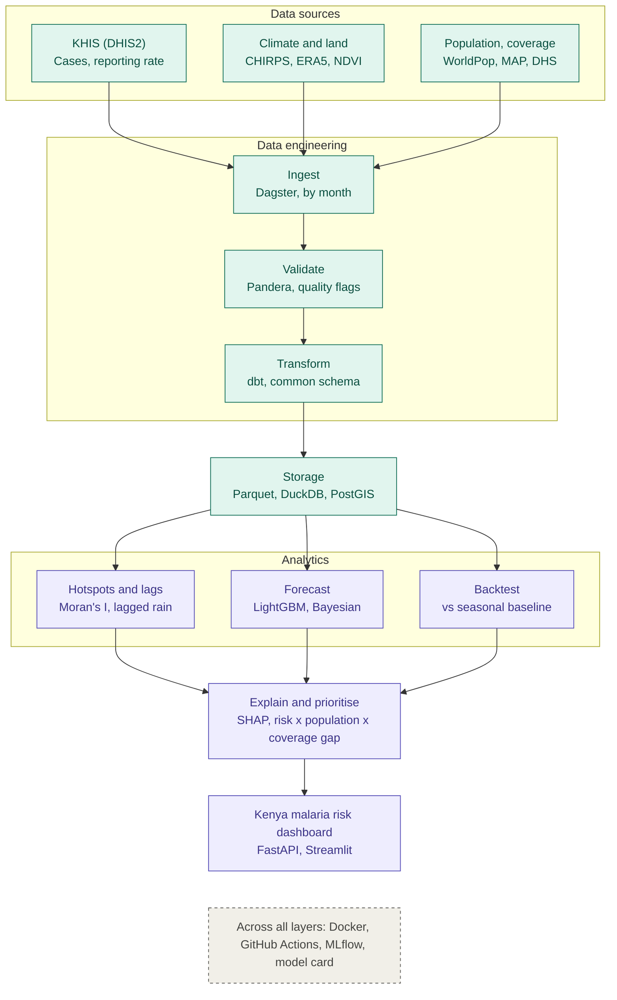

# Kenya Malaria Risk Pipeline

An open, reproducible pipeline and dashboard that forecasts county-level malaria risk in Kenya 1-3 months ahead, identifies hotspots, explains the factors associated with high risk, and ranks counties for intervention priority.

> **Status: in development.** Sections marked *(planned)* describe the intended design. Results will be added here once the backtests are complete.

## Decision question

> Which Kenyan counties need prioritised malaria interventions in the next 3 months?

## What it does

- **Ingests** epidemiological, climate, environmental and population data into a versioned, validated store
- **Monitors** malaria trends and seasonality by county
- **Identifies hotspots** using spatial statistics, with a stability check across years
- **Analyses** lagged relationships between rainfall, temperature and malaria incidence
- **Forecasts** short-term risk with prediction intervals, backtested against a seasonal baseline
- **Explains** why a county is flagged using per-county feature attributions
- **Prioritises** counties with a transparent score combining risk, population and intervention-coverage gap, with adjustable weights

## Architecture



The pipeline uses a **common schema** (country, admin unit, month, cases, tests, reporting rate) so that other countries using DHIS2 can be added with a small mapping config rather than new pipeline code.

## Data sources

| Data | Source | Resolution | Access |
|---|---|---|---|
| Malaria cases, tests, reporting rates | Kenya Health Information System (KHIS, DHIS2) | County, monthly | Approval required |
| Malaria incidence, prevalence, intervention coverage | Malaria Atlas Project (MAP) | Gridded, annual | Open |
| Malaria and nutrition indicators | Kenya Malaria Indicator Survey, DHS Program | Cluster / county | Registration required |
| Rainfall | CHIRPS | ~5 km, daily | Open |
| Temperature, humidity | ERA5-Land | ~9 km, hourly | Open |
| Vegetation, surface water, elevation | MODIS NDVI, JRC Global Surface Water, SRTM | 30 m - 1 km | Open |
| Population | WorldPop | ~1 km, annual | Open |
| County boundaries | GADM / Kenya open data | Vector | Open |

Check each source's current licence and terms before reuse. Raw files are stored with source, download date and version recorded.

## Repository structure *(planned)*

```
.
├── data/
│   ├── raw/               # untouched downloads (not committed)
│   └── processed/         # Parquet outputs
├── pipelines/             # Dagster assets: ingest, validate
├── dbt/                   # transformations to county-month tables
├── models/                # hotspots, lag analysis, forecasting, backtests
├── dashboard/             # FastAPI service and Streamlit app
├── docs/                  # model card, methods, policy brief
├── tests/
├── Dockerfile
└── README.md
```

## Getting started *(planned)*

```bash
git clone https://github.com/<your-username>/kenya-malaria-risk.git
cd kenya-malaria-risk
docker compose up
```

A single command should rebuild the pipeline from raw data to dashboard. Setup details will be added as the pipeline is built.

## Methods

- **Validation:** Pandera or Great Expectations checks for ranges, missing months and duplicates, plus a data-quality report on reporting completeness by county and month.
- **Hotspots:** Getis-Ord or local Moran's I, with a stability check across years.
- **Climate lags:** lagged rainfall and temperature analysis, reporting the estimated lag and its uncertainty.
- **Forecasting:** a seasonal-naive baseline, LightGBM with quantile prediction intervals, and optionally a hierarchical Bayesian spatiotemporal model.
- **Evaluation:** rolling-origin backtesting with a held-out recent period, compared against the seasonal baseline.
- **Explanation:** SHAP attributions per county, reported as associations rather than causes.
- **Prioritisation:** score = risk × population × coverage gap, with adjustable weights and a sensitivity check on how rankings change.

## Results

*To be added after backtesting: forecast skill versus baseline, prediction-interval coverage, hotspot stability and the sensitivity of the priority ranking.*

## Limitations

- Results are associations from observational data, not causal estimates.
- Climate variables explain only part of malaria risk. Interventions, health-seeking behaviour, migration and reporting quality also matter and are only partly captured.
- Surveillance counts depend on reporting completeness and testing rates, which vary by county and time.
- The prioritisation score is decision support for discussion. It is not an allocation rule and has not been validated with programme staff.
- Modelled surfaces (e.g. MAP) are estimates, not surveillance data, and are labelled as such wherever used.

## Roadmap

- [ ] Open-data ingestion: boundaries, CHIRPS, ERA5-Land, WorldPop, NDVI, elevation
- [ ] KHIS case data and the data-quality report
- [ ] Baseline and LightGBM forecasts with backtesting
- [ ] Hotspot and lag analysis
- [ ] Explanation and prioritisation layer
- [ ] Dashboard and policy brief
- [ ] Add a second country through the common schema

## Contributing

Issues and suggestions are welcome, especially from people working in malaria programmes or health information systems.

## Licence

Code: choose a licence (e.g. MIT or Apache-2.0) and add a `LICENSE` file. Data remains subject to each source's own terms.

## Acknowledgements

Data from the Kenya Ministry of Health (KHIS), Malaria Atlas Project, DHS Program, Climate Hazards Center (CHIRPS), Copernicus / ECMWF (ERA5-Land), WorldPop, NASA and JRC. Add formal citations as you use each dataset.